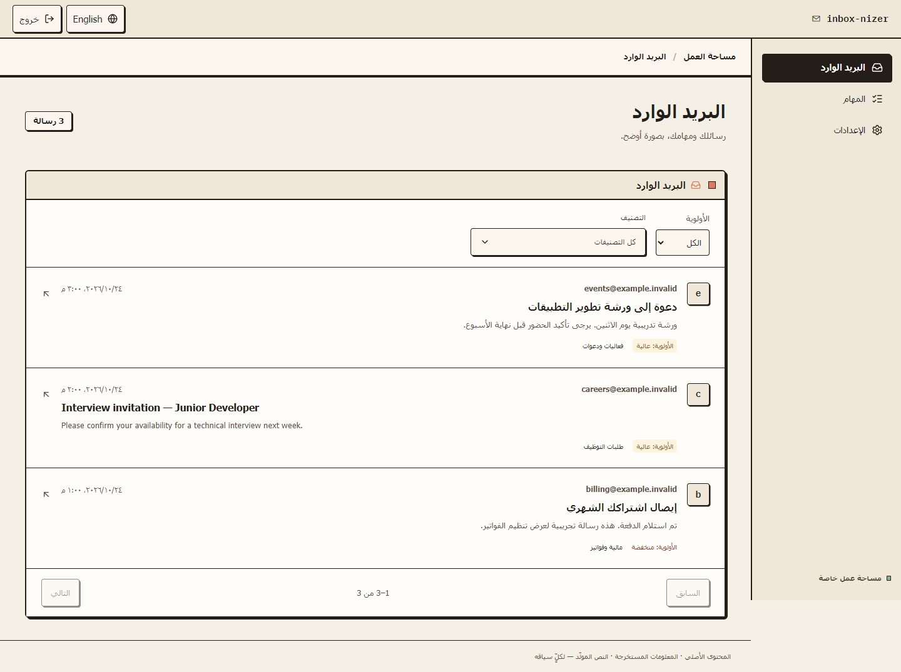
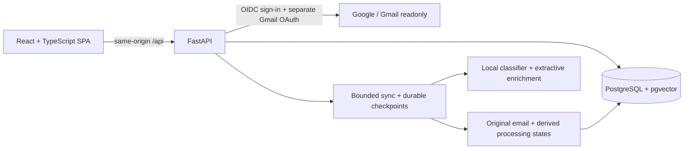

> **Phase 2 research:** reproducible dataset preparation, two real classifier fits and historical-model evaluation are recorded in [the research report](docs/phase2/README.md) and [model card](docs/phase2/MODEL_CARD.md). Results are English validation diagnostics; no production quality pass or Arabic accuracy is claimed. No serving model was replaced.

> **AI Engineering refocus — Phase 1 development branch.** This branch adds real model inference, source-grounded Ask, task extraction and Model Lab without a Gmail/DB dependency. See [the specification and local setup](docs/AI_SHOWCASE_SPEC.md). It has not been deployed; the hosted links and release history below describe earlier versions. The original Gmail application is preserved.

# Inbox-nizer

Inbox-nizer is a read-only Gmail organizer with an Arabic/English React interface.
It imports mail in small resumable batches and presents messages, category/priority
suggestions, extractive summaries and source-linked tasks in one workspace.

**[Try the interactive demo →](https://inbox-nizer-demo.onrender.com/)**

**PUBLIC PORTFOLIO DEMO: GO.** No login required. Explore 24 fictional messages,
category/priority filters, details, example summaries and source-linked tasks in
Arabic or English. This separate static website makes no Gmail, database or model
requests. [Demo architecture and live verification](docs/release/PUBLIC_DEMO.md).

**PORTFOLIO SOURCE RELEASE: COMPLETE**

**FULL GMAIL-CONNECTED PRODUCTION: NO-GO**

The source release is frozen for portfolio review, not production use. Classification
is **experimental and unapproved**. The release branch contains the tested application
and documented limitations. The live
Render service still runs an older commit. [PROJECT_STATUS.md](PROJECT_STATUS.md)
is the release contract and evidence ledger; [RENDER_RELEASE.md](deploy/RENDER_RELEASE.md)
contains the existing-host installation and recovery procedure.

The local candidate passed **1,380 backend tests and 162 frontend tests**; GitHub
backend/frontend CI also passed at `30d7c35` and `1d37c46`.
[GitHub Actions](https://github.com/tala-bulids/inbox-nizer/actions/workflows/ci.yml)
records checks for each published commit; see [final freeze evidence](docs/release/PORTFOLIO_FREEZE.md).
These checks prove application behavior under their stated fixtures, not production
capacity, real Google consent or classifier accuracy.

## Product preview

Actual production-build UI, using **synthetic example.invalid messages and mocked
API responses** with the render-free capability profile. The displayed categories,
summaries and connection state are fixtures, not live inference or Gmail results.
No private mailbox data appears in these screenshots.



[English inbox](docs/portfolio/inbox-en.png) · [Mobile connection settings](docs/portfolio/settings-mobile.png) · [Screenshot provenance](docs/portfolio/README.md)

The intended journey is Google app sign-in → separate Gmail read-only consent →
automatic bounded import → inbox/detail/tasks → incremental updates. Reload resumes
saved progress. Disconnect stops Gmail access while retaining imported data; reconnect
uses the same account. The browser drives continuation, so it must remain active.

## Architecture and runtime scope



The existing Render topology uses one Python process to serve the built SPA and
mounted API. Session cookies, CSRF validation, account ownership and encrypted OAuth
credentials protect the application boundary. Advisory locks serialize account sync;
Gmail IDs prevent duplicates. This is application ownership enforcement, not a claim
of database row-level-security policies.

| Capability | render-free | Full/local |
| --- | --- | --- |
| Inbox, details, summaries, tasks, Gmail connection/recovery | Implemented and tested locally | Preserved |
| Classification | FP32 ONNX implementation; provenance verified, quality unapproved | Existing experimental local classifier |
| Semantic Search / Ask | Navigation/routes disabled; API rejects before heavy inference | pgvector, local embeddings and optional Qwen/GGUF |
| Model downloads on a user request | None | Explicit offline provisioning required |

No paid inference API is used. Hosted dependencies exclude Torch, Transformers,
SentenceTransformer and llama-cpp; full/local implementations remain in the repository.
See [installation](#full-application-setup), [models](docs/MODELS.md) and
[validation](docs/VALIDATION.md) for requirements and limits.

## Demonstrated limitations

- ONNX provenance is verified against `results/checkpoint-3159`; fresh Torch/ONNX
  parity passed on 111/111 inputs. The original training report/split is unavailable.
- Classification remains **experimental/unapproved**. On 100 deliberately difficult,
  consumed development examples: English 20/56, Arabic-heavy 1/11, overall 32/100.
  These are **not representative accuracy**; language groups are heuristic. V10's
  untouched representative human-reviewed holdout is missing. Bilingual UI does not
  establish Arabic classification quality. [Exact evidence](docs/release/V03_V10_EVIDENCE.md).
- Linux memory/concurrent-workload capacity and actual hosted acceptance remain
  unverified. Empty platform metrics are not evidence of adequate capacity.
- An encrypted backup has operator-reported checksum/decryption/archive checks;
  a real isolated database restoration has not been tested.
- The current free database expires on **21 November 2026**. Continuity, coordinated
  credential rotation remain production blockers. The operator confirms the temporary
  external IP rule was removed and verified; no networking change is needed here.
- Invited-user access is the intended beta scope; this is not unrestricted public signup.

## Implemented features

- **Experimental classification:** a ten-label DistilBERT pipeline; the supported
  trainer uses weighted binary cross-entropy. No classifier is production approved.
  The product returns the highest-scoring label and its raw sigmoid score. That score
  is not a calibrated probability of correctness.
- **Inbox:** account-owned Gmail sync, filters, pagination, priority, clean message text,
  summaries, and conservative task/deadline extraction.
- **Search and Ask (full/local only):** local multilingual embeddings with pgvector, structured facts,
  literal extraction, clarification and optional local GGUF synthesis. Generated
  answers retain an unverified-synthesis notice and source links.
- **Authentication:** Google application sign-in, separate Gmail read consent, encrypted
  OAuth credentials, browser sessions with CSRF checks and operator bearer tokens.
- **Frontend:** Inbox, Email Detail, Search, Ask Mail, Tasks and Settings, with the
  existing retro design and Arabic/English presentation.

Categories: Business, Customer Support, Events & Invitations, Finance & Bills,
Job Application, Newsletters, Personal, Promotions, Reminders, Travel & Bookings.

## Install dependencies

Python 3.11 is the validated interpreter. Application use also needs PostgreSQL,
Google OAuth configuration and explicitly provisioned model artifacts. The optional
research commands below do not require Gmail or a web server.

```powershell
git clone --branch codex/inbox-nizer-release https://github.com/tala-bulids/inbox-nizer.git inbox-nizer
cd inbox-nizer
python -m venv env
.\env\Scripts\Activate.ps1
python -m pip install -r requirements.txt
```

On Linux/macOS activate with `source env/bin/activate`. Direct Python dependencies
are pinned to the tested environment; optional GGUF support is separate. CPU is supported.
For CUDA-specific PyTorch packages, follow PyTorch's instructions for your hardware.

## Optional classifier research workflow

Training is not required to launch the app with an explicitly provisioned local artifact, and
is outside the current V1 closure scope. Continue to [application setup](#full-application-setup)
when working on the product.

### Data and base model

Training accepts a local `.arrow` file, JSON list, or JSONL rows with `subject`, `body`
and a nonempty `labels` list. An already prepared `text` field is also supported.
A row looks like this; a single row is not enough to train:

```json
{"subject":"Interview invitation","body":"Please confirm your attendance.","labels":["Job Application"]}
```

Use sufficient independent examples to populate every training class. Contradictory
exact duplicates are quarantined. Template/near-duplicate groups and available sender
domains stay within one partition. Unsplittable datasets are rejected.

The original project used `imnim/multiclass-email-classification`. Download public data
and the base model explicitly when online, or provide your own authorized local data:

```powershell
hf download distilbert-base-uncased --local-dir results/distilbert-base
python -c "from pathlib import Path; from datasets import load_dataset; Path('results').mkdir(exist_ok=True); load_dataset('imnim/multiclass-email-classification', split='train').to_json('results/training.jsonl')"
```

Public annotations are not representative human-reviewed mailbox gold. The English
base model does not establish Arabic classification quality. Keep private data outside
Git; `results/` is ignored. Training and inference read local artifacts only.

### Training, prediction and evaluation

```powershell
python app.py --dataset-file results/training.jsonl --base-model results/distilbert-base --epochs 3
python predict.py --subject "Interview invitation" --body "Please confirm your attendance."
python evaluate.py --samples examples/evaluation.json --output results/evaluation.json
```

All three commands default to **`results/email-classifier`**, resolved against the
project directory. `EMAIL_MODEL_PATH` in the environment or project `.env` overrides
that shared location. `--output-dir` (training) and `--model` (prediction/evaluation)
override it for one command. Explicit relative artifact paths are also project-relative;
data/sample paths are relative to the shell's working directory.

Training refuses nonempty output directories. Evaluate a new candidate explicitly
before changing `EMAIL_MODEL_PATH`. Existing `results/checkpoint-3159` installations
remain usable by setting that path explicitly. No legacy weights are moved or replaced.

New artifacts from the supported trainer contain weights, tokenizer, label mappings, multi-label problem type, training
token limit, split manifest and training report. Prediction and evaluation share loading,
preprocessing, truncation and sigmoid scoring. Missing/incompatible artifacts fail
instead of downloading a substitute model. Model weights are not included in Git.

Validation macro F1 and top-one accuracy select the checkpoint, with early stopping.
The test partition is untouched unless `--evaluate-test` is explicitly requested for a
final diagnostic. Never repeatedly use test results to select candidates. The example
evaluation file is synthetic and is not an accuracy benchmark.

References: [DistilBERT](https://huggingface.co/docs/transformers/model_doc/distilbert)
and [model saving/loading](https://huggingface.co/docs/transformers/main_classes/model).

## Full application setup

Prerequisites: install dependencies above; explicitly provision a compatible classifier
artifact and set `EMAIL_MODEL_PATH` for experimental full/local use. Model weights and Google credentials
are intentionally not distributed with this repository. There is currently no approved
public classifier bundle, so a clean clone is not a turnkey hosted release. For
render-free serving, use the separate checked-in recipe only after its approval gates.

1. Install PostgreSQL with pgvector available. Provision an application database and a
   separate database ending in `_test`. Production needs distinct migration and
   restricted runtime roles.
2. Copy `.env.example` to `.env` and replace database placeholders. Generate a key with
   `python -c "from cryptography.fernet import Fernet; print(Fernet.generate_key().decode())"`
   and store it locally as `OAUTH_TOKEN_KEYS` for a new installation only. Preserve
   all existing key generations when restoring or continuing an installation.
3. For a **new empty development database**, run `python -m alembic upgrade head`.
   For an existing mailbox, first follow [backup, quarantine and ownership procedures](deploy/OPERATIONS.md).
   Maintenance/backfill scripts are not ordinary startup steps.
4. Configure a Google web OAuth client, save its JSON as `credentials.json` and register
   both callbacks from `.env.example`. Invite your verified address through
   `GOOGLE_LOGIN_ALLOWED_EMAILS`. Application login and Gmail consent are separate.
   Testing-mode OAuth apps also require an allowed Google Console test user.
5. Start the backend:

   ```powershell
   python -m uvicorn main:app --host localhost --port 8000 --no-access-log
   ```

6. In another terminal, run the frontend (Node 24+ recommended for browser checks):

   ```powershell
   cd frontend
   npm ci
   Copy-Item .env.example .env
   npm run dev
   ```

Open `http://localhost:5173`, sign in and connect Gmail in Settings. Recent-mail
preparation starts automatically; subsequent updates use saved Gmail History.
Keep the app active for continued work; reopening resumes committed progress.
Use `localhost` consistently for local cookies and callbacks. Swagger is at
`http://localhost:8000/docs`. Operator clients can provision a bearer token with
`python backend_admin.py create-user --name local-owner`.

Semantic search requires a locally cached `intfloat/multilingual-e5-small`; prepare it
with `hf download intfloat/multilingual-e5-small`. See [model setup](docs/MODELS.md) for
optional GGUF generation. Failed enrichment is recorded per message and can be retried.

More: [frontend](frontend/README.md), [deployment](deploy/README.md),
[bounded sync](deploy/BOUNDED_SYNC.md), [Google release requirements](deploy/GOOGLE_PUBLIC_RELEASE.md).
Real consent, hosted TLS, restore drills and production capacity need separate validation.

## Tests and checks

Offline classifier mechanics tests need no database or downloaded model:

```powershell
python -m pytest tests/unit --confcutdir=tests/unit -q
```

For the full suite, configure `DATABASE_URL` and a distinct `TEST_DATABASE_URL` ending
in `_test`, with pgvector available:

```powershell
python -m pytest -q
python -m unittest quality.test_local_classifier_review -v
python -m pip check
```

The full suite blocks production-engine connections and rolls back fixture rows.
A fresh test database is initialized through the migration chain. Real provider/model
benchmarks are opt-in. The classifier roundtrip uses tiny random weights and synthetic
data: it verifies pipeline mechanics, not prediction quality.

From `frontend/`:

```powershell
npm run api:generate
npm run typecheck
npm run lint
npm test
npm run build
```

GitHub Actions runs the backend with PostgreSQL/pgvector and the frontend checks.

## Project structure

```text
inbox-nizer/
  app.py, predict.py, evaluate.py       # Training, prediction and evaluation CLIs
  classifier_config.py                 # Shared artifact paths
  classifier_contract.py               # Labels, problem type and token limits
  main.py, routes.py, schemas.py        # FastAPI application and API
  authentication.py, browser_auth.py   # Bearer/session authentication
  google_login.py, gmail_*.py          # Sign-in, consent and bounded sync
  email_*.py, task_*.py, priority.py   # Cleaning and enrichment
  rag_*.py, fact_*.py, semantic_*.py   # Grounded answers and retrieval
  alembic/                             # Preserved migration history
  frontend/                            # React/TypeScript UI and tests
  quality/                             # Diagnostics and private review tools
  tests/unit/, test_*.py               # Classifier and integration tests
  examples/                            # Synthetic sample inputs
  deploy/, docs/                       # Current guides and historical notes
  results/, private_review/            # Local artifacts; ignored by Git
```

All 24 accessible local development commits are preserved above the original GitHub
commit, together with the reviewed accessible working-tree source. See
[source provenance](docs/SOURCE_AUDIT.md). Historical reports live in `docs/history/`;
their metrics are not new results or current production claims.
