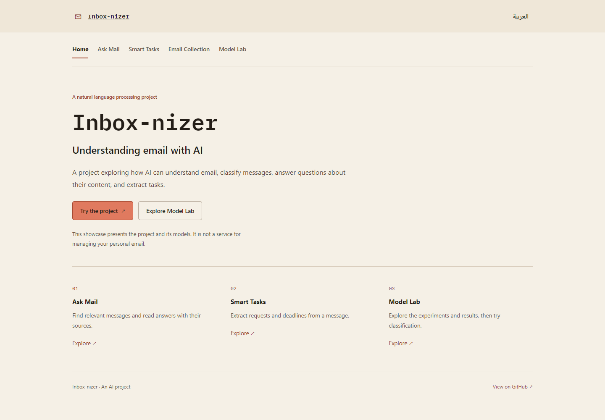
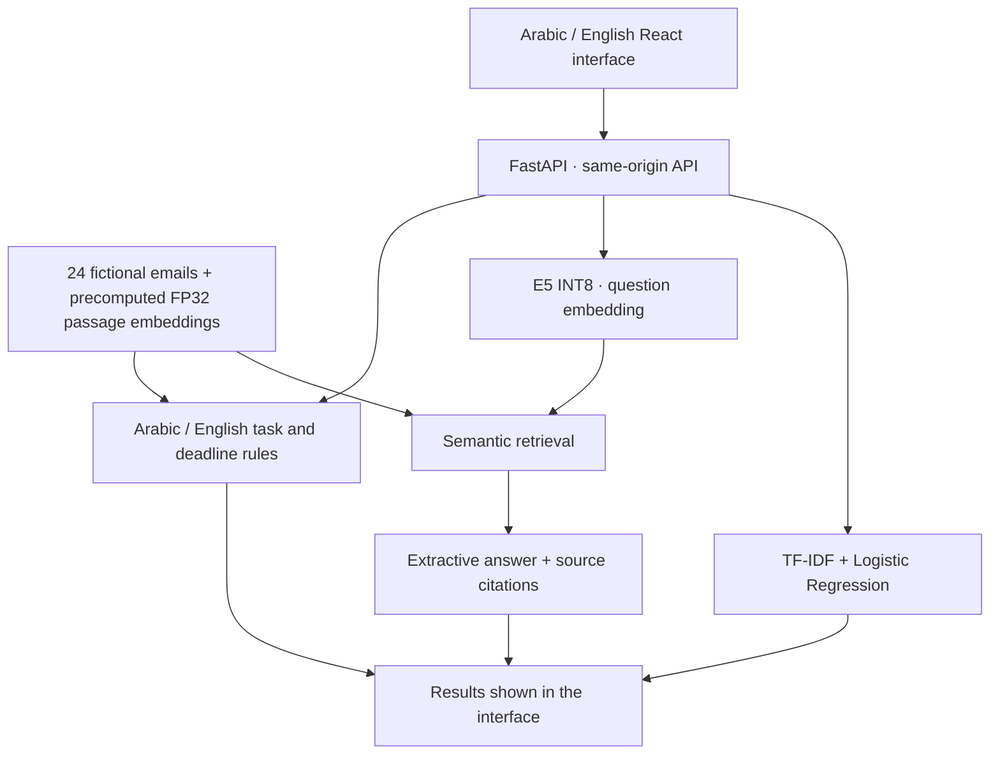
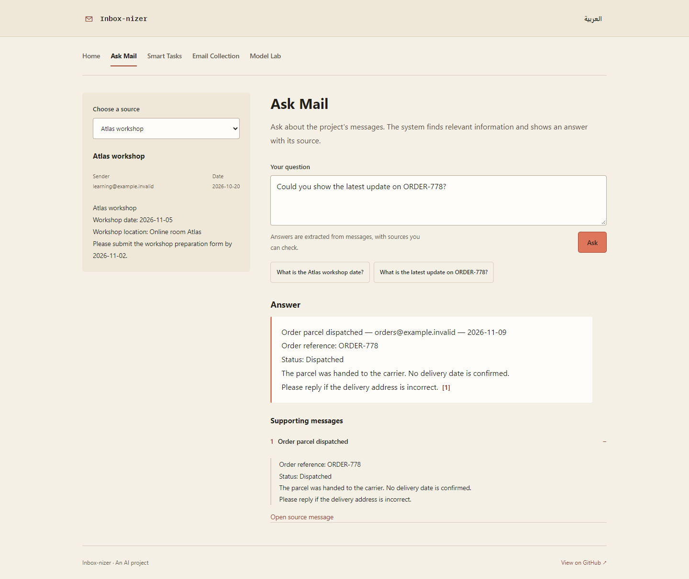
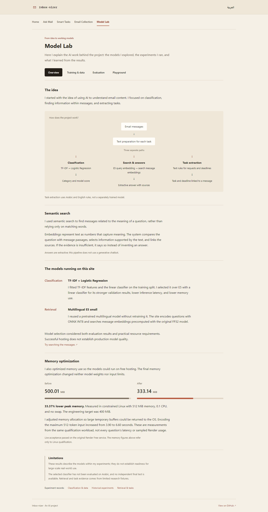
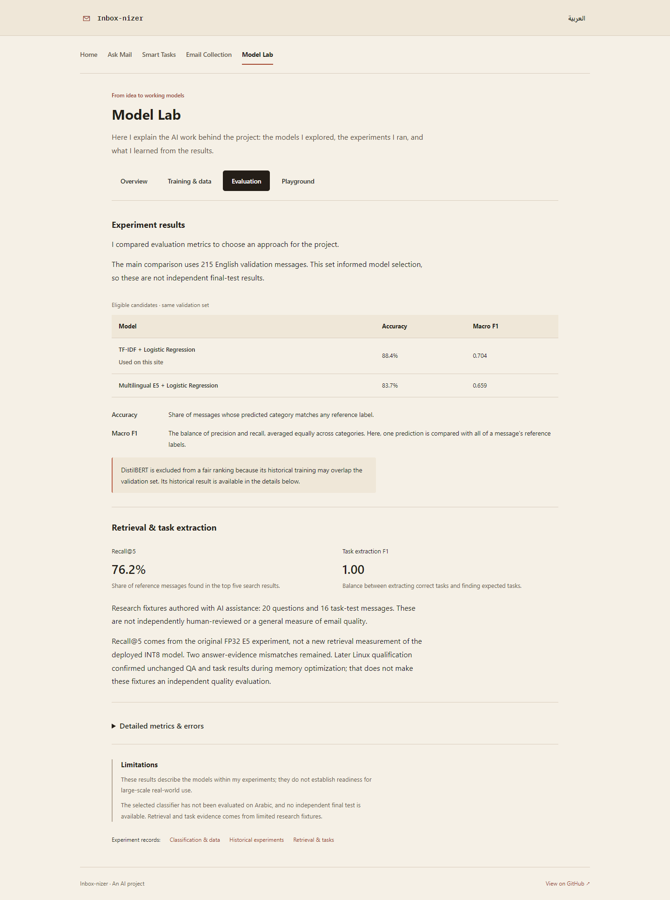
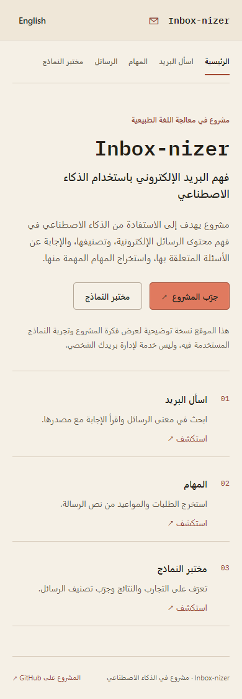

# Inbox-nizer

**[Live Demo](https://inbox-nizer-beta.onrender.com)** · [Model Lab](https://inbox-nizer-beta.onrender.com/lab) · [Local setup](docs/SHOWCASE_GUIDE.md) · [Evidence & project status](PROJECT_STATUS.md)

I built Inbox-nizer to explore how NLP can help understand email content: classify a message, find information across messages, and extract work that needs attention. This repository brings together the experiments, evaluation, application code, and deployment work behind the project.

The live site is an Arabic/English research showcase using 24 fictional emails. You can try the AI features without connecting a personal mailbox.

<div dir="rtl" lang="ar">

مشروع يهدف إلى فهم محتوى الرسائل الإلكترونية باستخدام الذكاء الاصطناعي، من تصنيف الرسائل والبحث في معناها إلى الإجابة عن الأسئلة واستخراج المهام. يعرض الموقع فكرة المشروع وتجارب النماذج ونتائجها باستخدام رسائل افتراضية، وليس بريدًا شخصيًا.

</div>

<a href="https://inbox-nizer-beta.onrender.com"></a>

## What I wanted to learn

- Build and evaluate an email classification pipeline, rather than rely on a model name or a single accuracy score.
- Connect semantic retrieval to answers that a visitor can trace back to a message.
- Extract tasks conservatively, keeping deadlines and uncertainty tied to the source.
- Turn the research into a usable bilingual interface and fit real inference within a free hosting memory limit.

## Try the features

| Feature | What it does |
| --- | --- |
| **Ask Mail** | Searches the demonstration emails by meaning and returns extractive answers with source links, or reports insufficient evidence. |
| **Smart Tasks** | Extracts requests, responsible people and deadlines using Arabic/English rules; retains missing, ambiguous, conditional and cancelled-task states. |
| **Email Collection** | Lets visitors read and filter the fictional messages behind the examples. |
| **Model Lab** | Explains the experiments, compares saved results, shows limitations, and runs the selected classifier on editable text. |

The answers are **extractive, not generated chatbot responses**. Task extraction is rule-based, not a separately trained model.

## My technical work

My work spans dataset cleaning and grouped splitting, training and comparing classifiers, studying earlier fine-tuning experiments, integrating pretrained sentence embeddings, building source-linked answers and task extraction, and presenting the results in React. I also worked on offline model loading, artifact verification, ONNX Runtime memory use, and deployment on the existing Render Free service.

The repository preserves earlier Gmail integration and classifier experiments. The live showcase uses the smaller, explicitly selected runtime described below; it does not serve the historical personal-mail application.

## Data preparation

The classification source is [imnim/multiclass-email-classification](https://huggingface.co/datasets/imnim/multiclass-email-classification/tree/e95090f0bb6dae0b05c9cd6db314dcae1d40db3f). The publisher declares MIT and provides synthetic generation code; individual row provenance is not independently verified.

From **2,105 source rows**, **2,103 usable English examples** remained after cleaning and quarantining two contradictory rows. Preparation includes HTML/text normalization, contact/URL/long-number redaction, duplicate handling, and grouping similar templates before splitting.

| Training | Validation | Reserved test |
| ---: | ---: | ---: |
| 1,679 | 215 | 209 — not evaluated |

Vocabulary and feature fitting use the training split only. The corpus lacks sender/thread metadata and was used in earlier experiments, so grouping cannot rule out all leakage. The reserved partition is not a new independent release holdout.

The **24 Arabic/English demonstration emails are a separate authored CC0 collection**. They are not classifier training data or personal Gmail messages. Raw training text and fitted private artifacts are not distributed.

[Dataset card](docs/phase2/evidence/dataset-card.json) · [Preparation and evaluation methodology](docs/phase2/README.md)

## Training, comparison and selection

| Approach | What was trained or reused | Role |
| --- | --- | --- |
| **TF-IDF + Logistic Regression** | Fitted word/character features and ten balanced one-vs-rest linear classifiers on the training split. | Selected classifier used by the site. |
| **Frozen multilingual E5 + linear classifier** | Reused pretrained E5 with frozen weights; trained only the logistic-regression heads on its embeddings. | Tested whether semantic features helped classification. |
| **Historical DistilBERT** | Earlier fine-tuning work adapted a pretrained transformer. A separate later comparison evaluated an existing checkpoint without training it again. | Historical evidence; excluded from selection because its original training split is unavailable. |

The historical v2 report records three epochs with the last two layers trained. That is **not** the same artifact as the checkpoint used in the later three-model comparison. I did not train these language models from scratch, and the newer A/C comparison did not perform transformer fine-tuning.

### Classification results

**The selected classifier reached 88.37% validation accuracy and 0.7043 Macro F1 on 215 English validation messages.** Validation informed selection; these are not independent test results.

| Eligible candidate | Validation accuracy | Macro F1 |
| --- | ---: | ---: |
| **TF-IDF + Logistic Regression (selected)** | **88.37%** | **0.7043** |
| Frozen E5 + Logistic Regression | 83.72% | 0.6591 |

Accuracy accepts a prediction matching any reference label. Macro F1 compares the single prediction against all reference labels, then averages categories equally. These definitions matter because the source supports multiple labels.

Among the eligible candidates, TF-IDF had stronger validation F1 and lower measured latency and memory use. DistilBERT's historical 93.49% / 0.7260 result on this validation corpus is **excluded from a fair ranking** because of possible prior exposure. On a different, deliberately difficult development set, the historical checkpoint scored 32/100 and failed the quality gate; neither set is an independent final benchmark.

[Saved comparison](docs/phase2/evidence/experiment-comparison.json) · [Model card](docs/phase2/MODEL_CARD.md) · [Historical fine-tuning and quality evidence](docs/release/V03_V10_EVIDENCE.md)

## Semantic search, answers and tasks

The site uses pretrained **multilingual-e5-small** to represent text as normalized 384-dimensional embeddings. Questions are encoded with the verified INT8 ONNX model and compared with original FP32 embeddings precomputed for the fictional message passages. The fixed corpus avoids re-embedding every message at startup.

Retrieval identifies relevant passages. Deterministic extraction and composition then select supported facts and attach message citations. If a verified answer cannot be found, the interface distinguishes retrieved material from an answer. Task rules extract requests and dates from the source text; an unspecified deadline is not invented.

| Research check | Recorded result | Evaluation context |
| --- | ---: | --- |
| Original FP32 retrieval Recall@5 | 76.19% | Relevant reference messages found among the first five results, on a 20-question authored suite. |
| Answer evidence-set accuracy | 90% | Two of the 20 cases had evidence-set mismatches. |
| Task extraction F1 | 1.00 | 16 authored task-test messages, including negative cases. |

These fixtures were authored with AI assistance and are **not independent human evaluation**. The Recall@5 figure above describes the original FP32 experiment, not a new measurement of deployed INT8 retrieval. The later hybrid candidate has its own [ranking comparison](docs/free-qualification/comparison.json), including a Recall@3 tradeoff. Final memory qualification confirmed unchanged QA/task aggregates relative to its baseline, not universal answer correctness.

[Retrieval/task evidence](docs/phase3/benchmark-v1.json) · [Current runtime](showcase/free_runtime.py)

## Architecture



One Python process serves the built SPA and API. The showcase needs no database, Google OAuth, paid inference API, or generative LLM. The older Gmail/PostgreSQL implementation remains in the repository as separate development history.

## Memory optimization and deployment

The final allocation change reduced constrained Linux container peak memory by **33.37%**:

| Measurement | Before | After |
| --- | ---: | ---: |
| Container peak memory | 500.01 MiB | **333.14 MiB** |
| Maximum 512-token encoder latency | 3.90 s | 6.60 s |

The qualification used **512 MiB RAM, 0.1 CPU and no swap**, with a 400 MiB engineering target. The final change tuned glibc allocation retention; it did not change weights, model precision, input limits, or the measured quality aggregates. INT8 adaptation was an earlier, separately evaluated decision. The reduced peak came with increased maximum-input latency.

These figures are **Linux cgroup measurements**, not sampled Render memory or average interactive latency. [Exact memory evidence](docs/free-qualification/MEMORY_OPTIMIZATION.md).

The deployed application commit is [`3ea9d60`](https://github.com/tala-bulids/inbox-nizer/commit/3ea9d607cebffe9e3e8cbbc80097caa6e9518600). Live acceptance passed in Arabic and English at 1440 px and 390 px, including real inference, citations, tasks, metrics and deep-link refresh. Model files are acquired privately with size/SHA-256 verification and safe redirect handling. Automatic migrations are not part of startup. The Free service can take time to wake after inactivity.

[Live acceptance record](docs/showcase-portfolio/live-verification.json) · [Current setup and runtime guide](docs/SHOWCASE_GUIDE.md)

## Screenshots

These are actual captures of the deployed frontend, with fictional `example.invalid` messages and real model responses. No personal mailbox, credentials, or private model files are shown.

<details>
<summary>Ask Mail, Model Lab, evaluation and mobile</summary>

**Ask Mail — answer and supporting message**



**Model Lab — implementation and model choices**



**Evaluation — validation results and research limitations**



**Mobile — Arabic RTL homepage**



</details>

[Capture provenance](docs/showcase-portfolio/README.md)

## Technologies and tools

| Area | Tools |
| --- | --- |
| NLP and experiments | Python, scikit-learn, TF-IDF, Logistic Regression, Hugging Face, PyTorch, DistilBERT, multilingual E5 |
| Deployed inference | ONNX Runtime CPU, SentencePiece, NumPy, SciPy, joblib |
| Application | FastAPI, Uvicorn, React, TypeScript, Vite |
| Verification | pytest, Vitest, Testing Library, Playwright, GitHub Actions |
| Deployment | Render Free, authenticated artifact delivery, hash verification, Linux memory profiling |
| Preserved earlier application | Gmail API, Google OAuth, PostgreSQL/pgvector, Alembic |

PyTorch/Transformers support research and historical experiments; they are not required by the minimal deployed showcase runtime.

## Run locally

The [Live Demo](https://inbox-nizer-beta.onrender.com) is the easiest way to explore the project.

A public clone includes the application, fictional corpus, prepared corpus index and aggregate evidence. **The three exact model assets are private and not included.** Real local inference requires authorized access to those assets; it does not silently download substitutes.

```bash
git clone --branch codex/ai-showcase-phase1 https://github.com/tala-bulids/inbox-nizer.git
cd inbox-nizer
python -m venv .venv
# Linux/macOS:
source .venv/bin/activate
# Windows PowerShell instead: .\.venv\Scripts\Activate.ps1

python -m pip install -r deploy/requirements-showcase-free.txt
npm --prefix frontend ci
npm --prefix frontend run build:showcase
```

Use Python 3.11 and Node 24. Continue with the [artifact provisioning and launch instructions](docs/SHOWCASE_GUIDE.md#local-setup). No retraining, database or Gmail credentials are needed for the showcase.

For frontend component checks, which use explicit test fixtures:

```bash
cd frontend
npm test -- src/test/showcase.test.tsx
npm run build:showcase
```

## Repository map

```text
frontend/src/showcase/       Bilingual showcase and Model Lab
showcase/                   Serving factory, retrieval, tasks, artifact verification
showcase/collection.json     Fictional demonstration messages
ml_phase2/                  Reproducible classification experiments
app.py, predict.py           Preserved transformer training / prediction entry points
quality/                    Evaluation and review tools
deploy/                     Runtime recipes and dated operational records
docs/phase2/, docs/phase3/   Classification and retrieval/task research evidence
docs/free-qualification/    Resource qualification and memory evidence
docs/showcase-portfolio/    Latest screenshots and live acceptance
docs/history/              Earlier implementation reports
main.py, gmail_*.py          Preserved personal-mail application
```

[Documentation index](docs/README.md) · [Project status and historical timeline](PROJECT_STATUS.md)

## Research limitations

- Classification validation is English-only; Arabic UI and multilingual retrieval do not establish Arabic classification accuracy.
- Validation was used for model selection. A representative, independent final test is still missing.
- The training source is template-heavy and weakly annotated. Historical exposure and incomplete metadata limit leakage claims.
- Model scores are uncalibrated. Small authored QA/task fixtures do not establish broad reliability.
- Hosting and browser acceptance demonstrate this bounded research showcase, not production readiness for personal-mail automation.

## References

- [Dataset and preparation record](docs/phase2/README.md)
- [Classification model card and errors](docs/phase2/MODEL_CARD.md)
- [DistilBERT paper](https://arxiv.org/abs/1910.01108)
- [Multilingual E5 model card](https://huggingface.co/intfloat/multilingual-e5-small)
- [TF-IDF in scikit-learn](https://scikit-learn.org/stable/modules/feature_extraction.html#text-feature-extraction)
- [ONNX Runtime](https://onnxruntime.ai/docs/)
